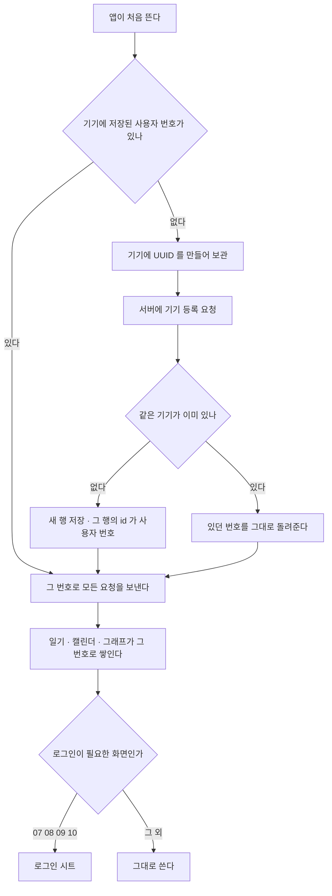

# 게스트 계정 비즈니스 로직

> 도메인: `com.jellydiary.account` · 엔티티 `GuestDevice`(테이블 `tb_guest_device`)
> 코드: `api/src/main/java/com/jellydiary/account/**` · 근거 ADR [로그인 없이 쓰는 게스트 모드](../../adr/2026-10-20-로그인-없이-쓰는-게스트-모드.md) · 갱신: 2026-10-20

## 1. 실행 흐름

**로그인해도 사용자 번호가 바뀌지 않는다.** 바뀌는 것은 `tb_profile.role` 하나다. 인증이 붙는 날 이 번호에 소셜 계정이 연결되기 때문에
기록을 옮기거나 합치는 절차가 아예 없다 - 게스트 모드에서 가장 비싼 부분을 설계로 없앴다.

## 2. 한눈에 보기

| 항목 | 내용 |
|---|---|
| 목적 | 로그인하지 않은 사람에게도 사용자 번호를 주어 핵심 루프를 열어 준다 |
| 시작 | 앱 첫 실행. 사용자는 아무것도 하지 않는다 |
| 주요 참여자 | 기기 1대 = 사용자 1명 |
| 완료 조건 | 앱이 사용자 번호를 손에 넣는다. 그 전에는 다른 화면을 그리지 않는다 |
| 열려 있는 것 | 02 홈 · 03 생성 · 04 결과 · 05 캘린더 · 06 그래프 |
| 막혀 있는 것 | 07 뱃지 · 08 커뮤니티 · 09 상점 · 10 마이페이지 |
| 하루 한도 | 게스트는 AI 생성 2회(최초 1 + 다시 그리기 1). 로그인하면 4회 |

## 3. 규칙

| # | 규칙 | 어디가 지키나 |
|---|---|---|
| 1 | 기기 1대에 사용자 번호 1개 | `ux_guest_device_hash` unique 인덱스 |
| 2 | 같은 기기가 다시 물으면 같은 번호 (멱등) | `GuestAccountService.register` |
| 3 | 기기 UUID 원문을 저장하지 않는다 | `Sha256.hex` 로 해시해서 넣는다 |
| 4 | 게스트는 하루 AI 생성 2회 | `DiaryPolicy.regenerateLimitFor(guest)` |
| 5 | 게스트는 커뮤니티에 쓸 수 없다 | `CommunityService.requireAccount` (403) |
| 6 | 일기는 로그인 여부와 무관하게 하루 1건 | `tb_diary` unique 인덱스 (바뀌지 않았다) |
| 7 | **게스트인지 아닌지는 프로필이 안다** | `Profile.role`(`GUEST`/`MEMBER`). 기기 행의 존재로 보지 않는다 |

**4번과 5번의 거절은 코드가 다르다.** `DIARY_GUEST_GENERATE_LIMIT` 와 `COMMON_LOGIN_REQUIRED`.
같은 코드로 뭉개면 앱이 어떤 안내를 띄울지 고를 수 없다(api-design 3장).

## 4. 경쟁 상태

같은 기기에서 두 요청이 동시에 등록을 시도하면 unique 인덱스가 한쪽을 막는다.
막힌 쪽은 **실패로 돌려주지 않고 먼저 들어간 행을 다시 찾아** 같은 번호를 받는다
(`GuestAccountService.create` 의 `DataIntegrityViolationException` 처리).
실패로 돌려주면 앱이 새 기기인 줄 알고 다시 등록해 기록이 둘로 갈린다.

## 5. 한계 (ADR 이 받아들인 것)

- **앱을 지우면 기록을 되찾을 수 없다.** 식별자가 기기에만 있기 때문이다. 로그인이 그 답이고,
  그래서 로그인 시트가 "쓰던 기록은 그대로예요"를 말한다
- 서버에 주인 없는 데이터가 쌓인다. 오래된 게스트 정리는 아직 없다(`batch-and-scheduler` 대상)
- 기기 식별자가 지워지면 새 번호가 생기고 **그날의 상한도 리셋된다.** iOS 키체인은 앱을 지워도 남지만
  안드로이드는 앱 데이터 삭제로 사라진다(ADR 2-2). 실모델이 붙는 날에는 서버 전체 일일 호출 상한이 따로 필요하다

## 6. 코드 위치

| 무엇 | 어디 |
|---|---|
| 엔티티 | `account/domain/GuestDevice.java` |
| 기기 등록(발급) | `account/service/GuestAccountService.java`. **권한은 여기서 보지 않는다** |
| 엔드포인트 | `account/controller/GuestController.java` (`POST /api/v1/guest/devices`) |
| 해시 | `common/util/Sha256.java` |
| 게스트 상한 | `diary/type/DiaryPolicy.java` · `diary/domain/Diary.java` |
| 권한 판정 | `profile/type/AccountRole.java` · `Profile.isGuest()` · `ProfileService.isGuest()` |
| 승격(로그인) | `Profile.promote()` - **아직 부르는 곳이 없다.** 인증이 붙는 자리다 |
| 커뮤니티 벽 | `community/service/CommunityService.java` |
| 앱 쪽 | `app/src/features/auth/**` (`AccountProvider`, `RequireAccount`, `LoginSheet`) |
