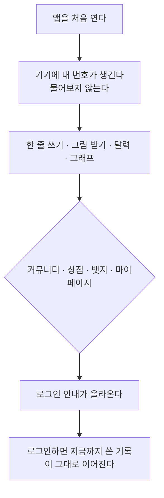

# 로그인 없이 쓰기

> 기능 소개 (비개발자용) · 상태: 동작함(인증은 아직) · 화면 02~11 · 갱신: 2026-10-20

## 무엇을 하는 기능인가

**계정을 만들지 않아도 일기를 쓰고 그림을 받을 수 있다.** 앱을 깔고 바로 한 줄을 적으면 된다.
쓴 기록은 달력과 그래프에 그대로 쌓인다.

커뮤니티처럼 남이 보는 자리와 결제가 붙는 자리는 로그인을 요구한다.

## 사용자가 하는 일

1. **그냥 쓴다.** 앱을 처음 열면 아무것도 묻지 않는다. 한 줄을 적으면 그림이 나온다.
2. **달력과 그래프를 본다.** 로그인 없이도 쌓인다.
3. **커뮤니티 같은 자리에 들어가면** 로그인 안내가 아래에서 올라온다. 뒤의 화면이 비쳐 보인다.
4. **로그인하면** 지금까지 쓴 일기가 그대로 남는다. 옮기거나 합치는 과정이 없다.

## 어디까지 로그인 없이 되나

| 화면 | 로그인 없이 |
|---|---|
| 홈(한 줄 쓰기) · 생성 중 · 결과 | 된다 |
| 감정 캘린더 · 감정 그래프 | 된다 |
| 뱃지 컬렉션 | 로그인 필요 |
| 커뮤니티 | 로그인 필요 |
| 테마·캐릭터 상점 | 로그인 필요 |
| 마이페이지 | 로그인 필요 |

## 규칙

| 항목 | 값 |
|---|---|
| 로그인 전 하루 그림 | **2번** (처음 1번 + 다시 그리기 1번) |
| 로그인 후 하루 그림 | 4번 (처음 1번 + 다시 그리기 3번) |
| 하루 일기 수 | 1건 (로그인 여부와 무관) |
| 내 번호가 사는 곳 | 기기 안전 저장소. 서버는 기기 식별자 원문을 보관하지 않는다 |

## 예외 상황에서 어떻게 보이나

| 상황 | 사용자에게 |
|---|---|
| 로그인 전에 오늘 그림을 2번 다 썼다 | "오늘 그릴 수 있는 횟수를 다 썼어요. 로그인하면 더 그릴 수 있어요." |
| 커뮤니티·상점·뱃지·마이페이지에 들어갔다 | 로그인 안내가 올라온다. 닫으면 홈으로 돌아간다 |
| 서버에 연결할 수 없다 | 처음 실행이면 "다시 시도"가 뜬다. 한 번이라도 열었던 기기는 그냥 열린다 |

## 아직 이런 점이 있다

> [!NOTE]
> - **로그인이 아직 동작하지 않는다.** 안내에 Apple·Google 버튼이 있지만 누르면 "인증이 아직
>   붙지 않았어요"가 뜬다. 그래서 지금은 **"그냥 둘러보기"로 통과할 수 있다** - 인증이 붙는 날 사라진다.
> - **앱을 지우면 기록을 되찾을 수 없다.** 내 번호가 기기에만 있기 때문이다. 로그인이 그 답이다.
> - 광고를 보면 그림을 더 그릴 수 있게 하는 것은 다음 차례다.

## 더 보기

결정의 배경: `../adr/2026-10-20-로그인-없이-쓰는-게스트-모드.md` ·
동작 규칙: `../domain/account/게스트계정-비즈니스로직.md` · 화면: `../screen/11-login.md`
