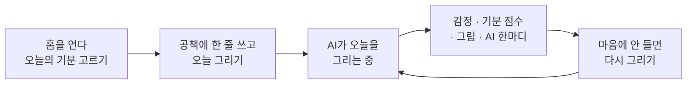

# 오늘 한 줄 기록

> 기능 소개 (비개발자용) · 상태: 동작함 · 화면 02·03·04 · 갱신: 2026-10-20

## 무엇을 하는 기능인가

하루에 한 줄을 적으면 AI가 그 문장의 감정을 읽어 **감정 9종으로 판정하고 그림으로 그려 준다.**

## 사용자가 하는 일

1. **오늘의 기분 고르기** - 홈에 들어오면 감정 9종이 옆으로 늘어서 있다. 하나를 고른다.
   **고르지 않으면 그릴 수 없다** - 같은 문장도 쓴 사람의 기분에 따라 다른 날이기 때문이다.
   고르고 나면 "얼마나"를 -2 ~ +2 로 더 고를 수 있다(선택).
2. **한 줄 쓰기** - 줄이 그어진 공책에 "오늘 어땠나요?"에 적는다. **200자까지.**
   쓰는 만큼 종이가 늘어나고, 180자가 넘으면 글자 수가 주황으로 바뀐다. **하루에 한 번만** 쓸 수 있다.
3. **기다리기** - "오늘 그리기"를 누르면 대기 화면이 덮인다. 색연필이 그림을 칠해 나가는 자리와 방금 쓴 한 줄이 보이고,
   보통 20초쯤 걸린다. 다 그려지면 결과가 저절로 나타난다.
   - **기다리지 않아도 된다.** "나중에 볼게요"를 누르거나 어두운 바탕을 누르면 대기 화면이 접히고,
     홈에는 "그리는 중" 띠만 남는다. 다른 탭을 봐도 그림은 계속 그려진다.
   - 5분이 지나도록 소식이 없으면 앱이 더 묻지 않고 기다린다. 그때는 **"지금 확인하기"**로 직접 물어본다.
4. **결과 보기** - 감정 1종, 기분 점수, AI 한마디, 그림.
5. **다시 그리기** - 같은 글로 다시 그릴 수 있다. **하루 3번까지.**
6. **최근 기록** - 홈 아래에 최근 3일의 감정과 글이 보인다.

## 규칙

| 항목 | 값 |
|---|---|
| 하루 기록 수 | 1건 |
| 글자 수 | 1~200자 |
| 오늘의 기분 | **고르는 것이 필수.** 9종 중 하나 |
| 감정 종류 | 행복한, 활기찬, 무난한, 부끄러운, 황당한, 피곤한, 슬픈, 우울한, 화난 (9종). 과일 캐릭터로 그린다 |
| 감정 세기 | 기분을 고르면 -2 ~ +2 로 세기를 더 고를 수 있다(선택). 감정마다 고를 수 있는 쪽이 다르다 |
| 기분 점수 | -3 ~ +3 |
| 다시 그리기 | 하루 3번 |
| 하루의 기준 | 한국 시간 자정 |

## 예외 상황에서 어떻게 보이나

| 상황 | 사용자에게 |
|---|---|
| 오늘 이미 썼다 | "오늘은 이미 기록했어요" |
| 기분을 고르지 않았다 | "오늘 그리기" 버튼이 눌리지 않고 그 아래에 "오늘의 기분을 먼저 골라 주세요" |
| 기분만 고르고 아무것도 안 썼다 | 같은 자리에 "오늘 한 줄을 써 주세요" |
| 그림만 실패했다 | 글과 판정은 그대로 남고, 그림 자리에 "그림을 만들지 못했어요" |
| 감정 분석까지 실패했다 | "오늘을 그리지 못했어요. 다시 시도해 볼까요?" |
| 다시 그리기를 3번 다 썼다 | "오늘은 더 다시 그릴 수 없어요" |
| 인터넷이 끊겼다 | 입력한 글은 화면에 남는다 |
| 그리는 데 오래 걸린다 | 20초 · 1분 · 5분을 넘길 때마다 안내 문구가 바뀐다. 진행률(몇 %)은 보여주지 않는다 - 서버가 알려주지 않는 값을 지어내지 않는다 |

## 아직 이런 점이 있다

> [!NOTE]
> - 감정 판정이 **정해진 단어 규칙**으로 동작한다("합격"이 들어가면 무지개, "힘들"이 들어가면 비). 진짜 AI 모델은 아직 붙지 않았다.
> - 그림도 임시 이미지다.
> - 앱을 꺼 둔 사이에 다 그려져도 알려주지 않는다(완료 알림 없음). 대기 화면을 접어 두면 홈에서 확인한다.
> - 기다린 시간은 **대기 화면이 뜬 때부터** 센다. 앱을 껐다 켜면 다시 0부터다.
> - 홈의 "연속 기록" 숫자는 아직 계산하지 않는다.
> - 고른 기분은 AI 에게 주는 **참고**지 결과가 아니다. 결과 화면의 감정이 고른 것과 다를 수 있다.
> - 세기(-2 ~ +2)는 아직 서버로 보내지 않는다. 화면에서만 쓰인다.

## 더 보기

동작 규칙과 상태 변화: `../domain/diary/일기생성-비즈니스로직.md` · 화면별 명세: `../screen/02-home.md`, `03-generating.md`, `04-result.md`
